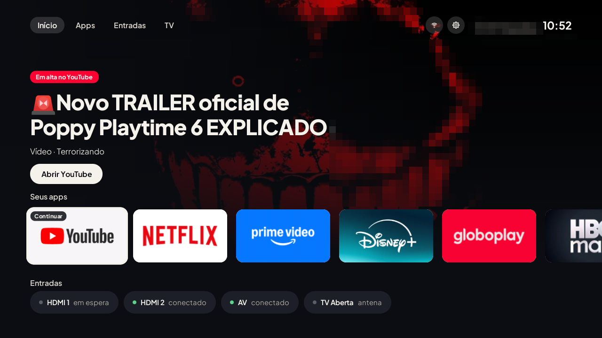
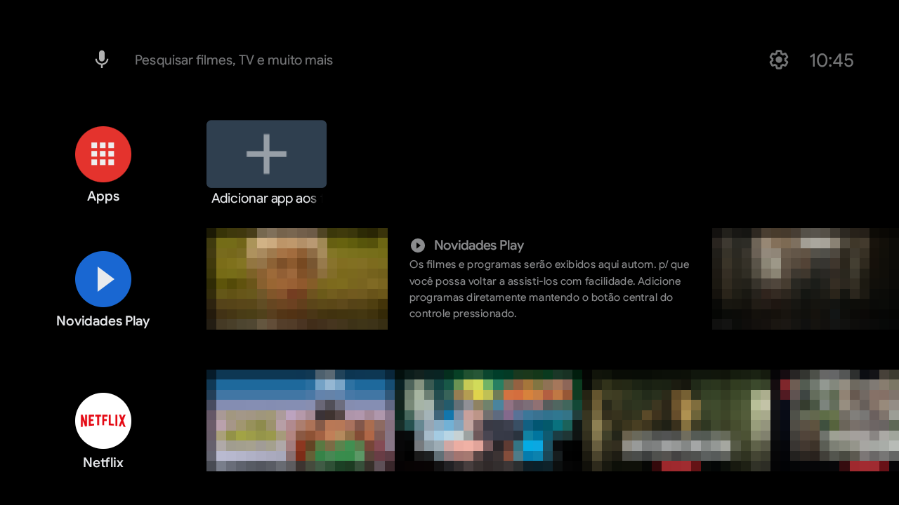
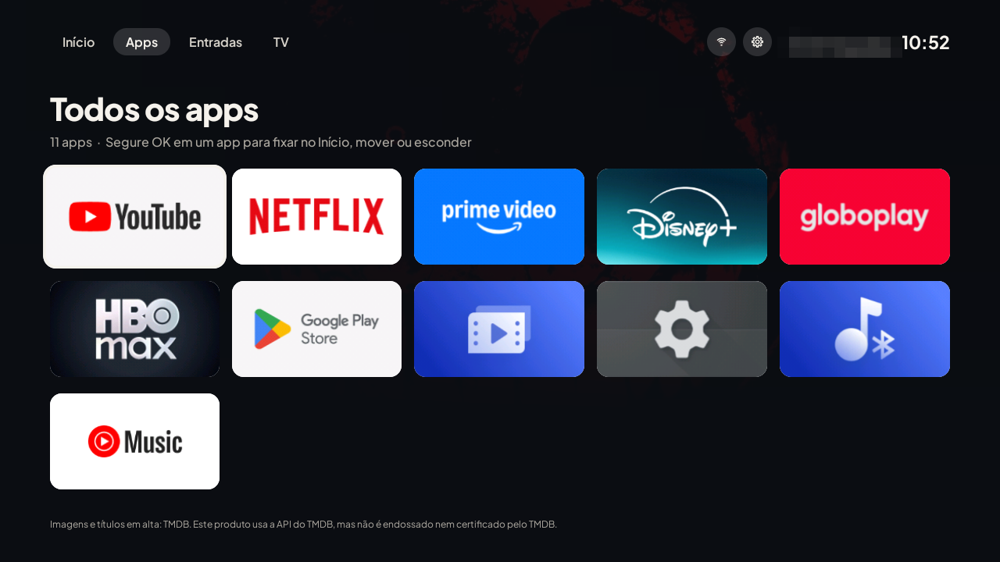
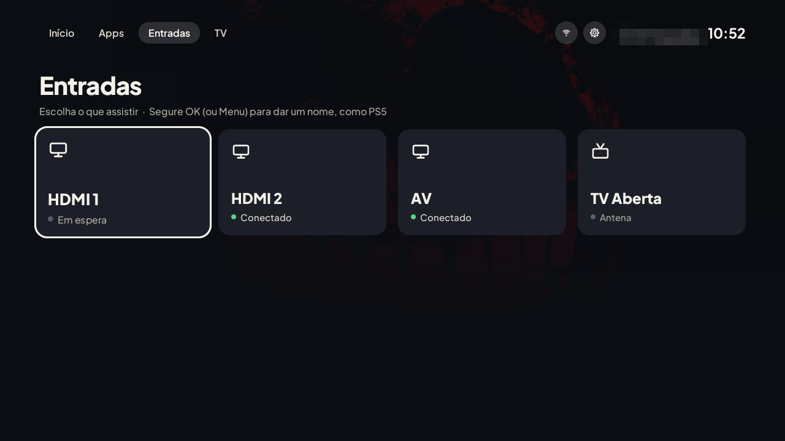
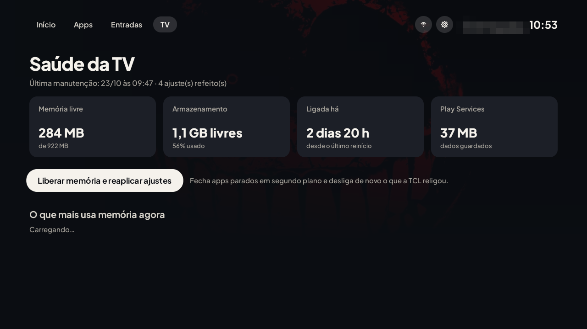
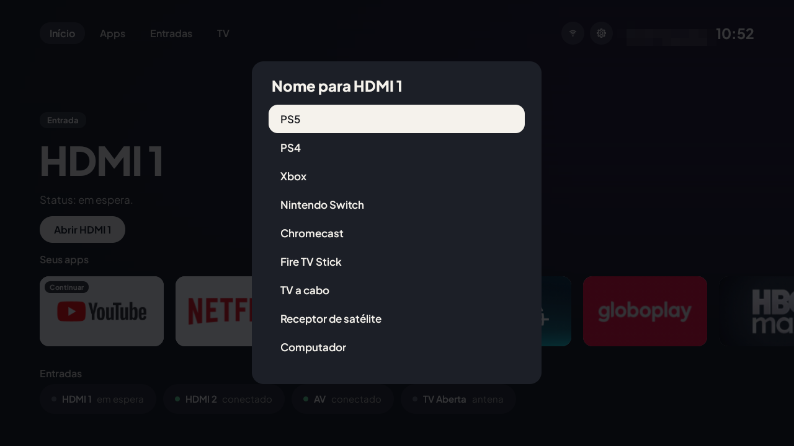
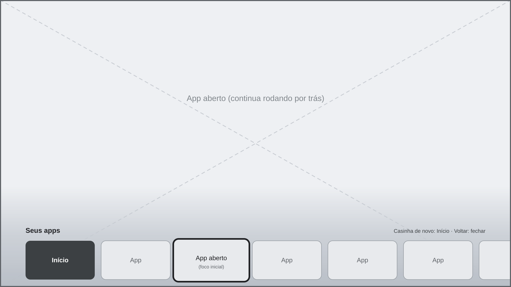

# TvClean: uma TV TCL lenta, rápida de novo

Uma tela inicial leve para Android TV e os scripts que tiraram uma TCL de 2021 do "travando em
tudo": limpeza de apps de fábrica, ajustes de memória e manutenção automática. Sem root e reversível.



Feito para uma TCL com MediaTek MT9221 (`C06_2K_GB`), Android TV 11 e 943 MB de RAM. O launcher
roda em qualquer Android TV 8+; os scripts servem de modelo para outras TVs.

> [!WARNING]
> **Projeto pessoal, testado em uma única TV.** Faça backup antes e confira cada mudança no aparelho.
> **Não use se você depende de acessibilidade:** o leitor de tela, a leitura em voz alta e o assistente
> de voz ficam desligados, e o launcher ocupa o serviço de acessibilidade do sistema.

**Sumário:** [O problema](#o-problema) · [Antes e depois](#antes-e-depois) ·
[O que tem](#o-que-tem) · [Instalar](#instalar) · [Desfazer](#desfazer) ·
[Segurança](#segurança) · [Limitações](#limitações) · [Estrutura](#estrutura-do-repositório)

## O problema

A TV estava quase inutilizável:

- **Disco cheio:** 100% do armazenamento ocupado (3,8 MB livres de 2,5 GB). Só o Google Play Services
  guardava 1,2 GB.
- **Sem atualizações:** sem espaço, a Play Store não atualizava nada. YouTube, Chromecast, WebView e
  outros ficaram presos em versões antigas.
- **Travamentos:** com ~105 MB de RAM livre, abrir um app ou voltar ao Início mostrava tela branca ou
  preta por vários segundos.

## Antes e depois

### A TV inteira (todo o projeto aplicado)

| | Antes | Depois |
|---|---:|---:|
| Armazenamento usado | 100% (3,8 MB livres) | ~55% (1,1 GB livres) |
| RAM livre em uso normal | ~105 MB | ~200–380 MB |
| Atualizações pela Play Store | Bloqueadas | Funcionando |

### Launcher original × TvClean

| Launcher original (Google TV) | TvClean |
|---|---|
|  |  |

Medido na mesma TV, no mesmo dia (23/10/2026), com os mesmos comandos para os dois:

| | Original | TvClean | Como foi medido |
|---|---:|---:|---|
| Abrir o Início com o launcher fechado | 0,75–1,19 s | 0,54–1,28 s | `am start -W` (HOME), 3 vezes |
| Memória do launcher | 85 MB | 76 MB | `dumpsys meminfo <pacote>`, TOTAL PSS |
| Tamanho do app | — | 249 KB | APK final |

No tempo de abertura os dois empatam: a diferença está dentro da variação entre medições. O ganho
do TvClean está no resto: menos coisa rodando ao fundo, nada de recomendações carregando da internet,
e a manutenção que impede a TV de voltar ao estado de antes.

> As capturas pixelam pôsteres e capas (arte de terceiros) e a cidade do clima no cabeçalho.

## O que tem

### Launcher (`launcher/`)

App Android em Java puro, sem bibliotecas de terceiros.

| | |
|---|---|
|  |  |
|  |  |

- **Início** com o que está em alta no streaming em foco ([TMDB](https://www.themoviedb.org/)) e o
  vídeo mais popular do YouTube, trocando a cada 3 horas. Nada com classificação 18 (ou sem
  classificação) aparece.
- **Favoritos:** segure OK (ou aperte Menu) num app para fixar, mover ou esconder. O último app usado
  vem primeiro, marcado como **Continuar**.
- **Entradas** (HDMI, AV, antena) com estado ao vivo e nome personalizável, como "PS5".
- **Aba TV:** memória, armazenamento, tempo ligado, o que mais gasta memória e o botão
  **Liberar memória e reaplicar ajustes**.
- **Manutenção automática:** a cada 6 horas o launcher redesliga o que a TCL religou e reaplica os
  ajustes de memória, pela depuração da própria TV, sem PC.
- **Barra de apps:** dentro de qualquer app, a casinha abre a barra por cima; um segundo aperto vai ao
  Início. Segurar a casinha abre um painel de atalhos.

  
- Clima no cabeçalho ([Open-Meteo](https://open-meteo.com/)) e um protetor de tela com as imagens em
  alta, relógio e clima.

### Scripts da TV (`tv/`)

PowerShell + adb, rodando no PC. Todos conferem se o aparelho é **esta TV** (modelo e número de série)
e param se não for.

| Script | O que faz |
|---|---|
| `debloat.ps1` | Desliga os apps de `debloat.txt` e aplica os ajustes de `common.ps1`. `-Undo` desfaz. |
| `check.ps1` | Acha o que voltou depois de um reboot e corrige. `-ReportOnly` só mostra. |
| `cleanup.ps1` | Libera espaço: dados e atualizações dos apps desligados, APKs largados, caches. |
| `measure.ps1` | Mede a abertura dos apps (a frio e a quente), a volta ao Início e o uso de swap. |
| `startup.ps1` | Cronometra o Início em cenários diferentes (`-Scenario home`, `killed`, `dream`, `reboot`). |

## Instalar

### Requisitos

- Windows com PowerShell 5.1+ e o `adb` do Android SDK Platform-Tools.
- JDK 17 e Android SDK com `platforms/android-34` e `build-tools/34.0.0`. O build não usa Gradle:
  `aapt2 → javac → d8 → zipalign → apksigner`.
- Na TV: **Opções do desenvolvedor → Depuração USB** ligada. Nesta TCL isso já abre o adb pela rede,
  na porta 5555.

### Chaves (opcionais)

Sem chaves o launcher funciona, só não mostra o que está em alta. Crie fora do Git (já ignorados):

- `tv/tmdb.key`: chave ou token de leitura da [API do TMDB](https://www.themoviedb.org/settings/api).
- `tv/youtube.key`: chave da YouTube Data API v3, restrita ao app `com.tvclean.home` + SHA-1 do
  certificado.
- `tv/city.txt`: cidade do clima. Sem ele, a TV usa a localização aproximada da conexão.

### Compilar e instalar

```powershell
.\launcher\build.ps1                            # gera launcher\build\TvClean.apk
.\launcher\install.ps1 -TvHost 192.168.x.x      # instala, vira o Início e desliga o launcher de fábrica
.\tv\debloat.ps1 -TvHost 192.168.x.x            # primeira vez: desliga os apps da lista e aplica os ajustes
.\tv\check.ps1 -TvHost 192.168.x.x -ReportOnly  # confere: deve terminar em "Tudo em ordem."
```

Se o PowerShell recusar os scripts, rode com `powershell -ExecutionPolicy Bypass -File <script>`.

Depois de instalar ou atualizar o launcher:

1. Rode `.\tv\check.ps1 -TvHost 192.168.x.x`: a atualização desliga o serviço da barra e o script religa.
2. **Reinicie a TV:** a TCL só ativa esse serviço na inicialização.
3. Na primeira vez que usar **Liberar memória** (aba TV), a TV pergunta "Permitir a depuração USB?"
   para o próprio launcher: marque **Sempre permitir**.

O keystore de assinatura fica em `%USERPROFILE%\.tvclean` (ou em `TVCLEAN_KEYS`) e é criado no
primeiro build. **Guarde um backup dessa pasta:** atualizações precisam da mesma chave.

## Desfazer

```powershell
.\tv\debloat.ps1 -TvHost 192.168.x.x -Undo              # religa tudo e volta os ajustes ao padrão
.\launcher\restore.ps1 -TvHost 192.168.x.x -Uninstall   # volta o launcher de fábrica e remove o TvClean
```

Nada é desinstalado da TV: os apps só ficam desligados (`pm disable-user`).

## Segurança

- **Depuração pela rede fica ligada** (a manutenção automática depende dela). Qualquer aparelho na sua
  rede pode pedir acesso: **nunca aceite** "Permitir a depuração USB?" se não foi você que pediu.
- **As chaves de API vão dentro do APK.** Depois de distribuído, o APK não guarda segredo: restrinja as
  chaves no provedor, use um projeto do Google Cloud sem faturamento e revogue qualquer chave exposta.
- O serviço de acessibilidade lê só a tecla Início, nunca o conteúdo da tela.
- Ficam fora do Git: `tv/*.key`, `tv/tv.serial`, `tv/city.txt`, `backup/`, `tv/measurements/`,
  `launcher/build/` e o keystore. Antes de um commit, confira com `git status --short`.

## Limitações

- A TCL só liga serviços de acessibilidade no boot: depois de atualizar o launcher, reinicie a TV.
- Teclas enviadas pelo adb não passam pelo filtro de acessibilidade desta TV. Teste a barra e o painel
  com o controle de verdade.
- Sem root não dá para ler o "continuar assistindo" dos streamings nem reiniciar a TV pelo app.
- A TCL religa alguns apps sozinha no boot. A manutenção automática (no máximo a cada 6 horas)
  desliga de novo; para corrigir na hora, use **Liberar memória** na aba TV ou `tv\check.ps1`.

## Estrutura do repositório

```text
launcher/
  src/com/tvclean/home/   código do app (tela, barra, protetor de tela, manutenção)
  res/  assets/           recursos e a fonte Plus Jakarta Sans
  build.ps1  install.ps1  restore.ps1
tv/
  common.ps1              lista de ajustes e funções usadas por todos os scripts
  debloat.txt             apps de fábrica que ficam desligados, com comentários
  *.ps1                   debloat, check, cleanup, measure, startup
docs/
  images/                 capturas e wireframes usados neste README
  plano-otimizacao.md     diagnóstico, medições e próximas etapas
```

## Créditos

- Inspirado em [cleanyourtv](https://github.com/Gathin23/cleanyourtv) (lista de apps da TCL 40S5400A,
  mesma plataforma).
- Títulos e imagens em alta: [TMDB](https://www.themoviedb.org/). Este produto usa a API do TMDB, mas
  não é endossado nem certificado pelo TMDB. Vídeos em alta: YouTube Data API.
- Fonte [Plus Jakarta Sans](https://github.com/tokotype/PlusJakartaSans), licença SIL OFL 1.1
  (`launcher/assets/PlusJakartaSans-OFL.txt`).

## Licença

[MIT](LICENSE). A fonte Plus Jakarta Sans segue a própria licença (SIL OFL 1.1).
